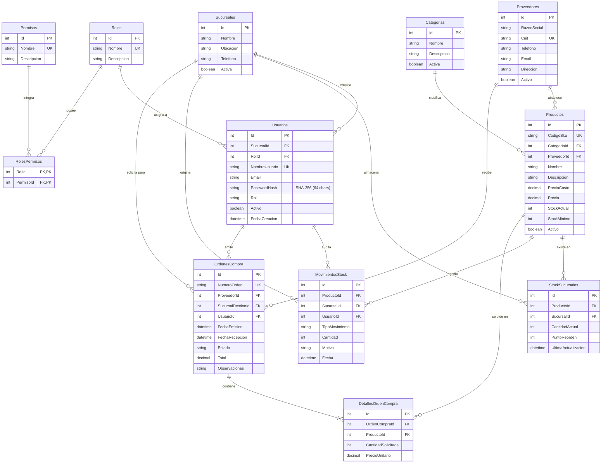

# Modelo Canónico de Base de Datos - Control de Inventario y Stock

El modelo de datos relacional para el sistema de Control de Inventario y Stock de la distribuidora se compone de **12 entidades** que cubren de extremo a extremo la operatoria logística: el catálogo de productos y categorías, la existencia desglosada por sucursal, la trazabilidad de movimientos, el abastecimiento mediante proveedores y órdenes de compra, y el módulo de seguridad RBAC con contraseñas encriptadas en **SHA-256**.

## Entidades y Relaciones

### 1. `Roles` (Módulo de Seguridad)
Define los distintos perfiles de acceso (ej. Administrador, Gerente Logística, Operador Depósito).
- **Id** (PK): Identificador único (`SERIAL`).
- **Nombre**: Nombre del rol (`UNIQUE`, `VARCHAR(50)`).
- **Descripcion**: Detalle del propósito del rol (`TEXT`).

### 2. `Permisos` (Módulo de Seguridad)
Representa acciones específicas en el sistema (ej. `VER_DASHBOARD`, `GESTIONAR_PRODUCTOS`, `REGISTRAR_MOVIMIENTOS`, `EMITIR_ORDENES_COMPRA`).
- **Id** (PK): Identificador único (`SERIAL`).
- **Nombre**: Nombre interno del permiso (`UNIQUE`, `VARCHAR(80)`).
- **Descripcion**: Explicación legible del permiso (`TEXT`).

### 3. `RolesPermisos` (Módulo de Seguridad)
Tabla intermedia que resuelve la relación N:M entre roles y permisos.
- **RolId** (FK, PK): Clave foránea referenciando a `Roles(Id)`.
- **PermisoId** (FK, PK): Clave foránea referenciando a `Permisos(Id)`.

### 4. `Sucursales`
Representa los centros de almacenamiento o distribución físicos de la empresa.
- **Id** (PK): Identificador único (`SERIAL`).
- **Nombre**: Nombre comercial de la sucursal (`VARCHAR(100)`).
- **Ubicacion**: Dirección física o zona geográfica (`VARCHAR(200)`).
- **Telefono**: Teléfono de contacto de la sucursal (`VARCHAR(50)`).
- **Activa**: Estado operativo (`BOOLEAN`).

### 5. `Usuarios` (Módulo de Seguridad y Auditoría)
Maneja la autenticación y el control de acceso al sistema.
- **Id** (PK): Identificador único (`SERIAL`).
- **SucursalId** (FK): Clave foránea referenciando a `Sucursales(Id)`.
- **RolId** (FK): Clave foránea referenciando a `Roles(Id)`.
- **NombreUsuario**: Identificador de inicio de sesión (`UNIQUE`, `VARCHAR(50)`).
- **Email**: Correo electrónico corporativo (`VARCHAR(120)`).
- **PasswordHash**: Contraseña encriptada mediante algoritmo **SHA-256** (`VARCHAR(64)`).
- **Rol**: Nombre del rol activo para autorización en sesión (`VARCHAR(30)`).
- **Activo**: Estado de la cuenta (`BOOLEAN`).
- **FechaCreacion**: Fecha de alta del usuario (`TIMESTAMP`).

### 6. `Categorias`
Agrupa los productos en distintas familias para facilitar el filtrado y la visualización en el tablero.
- **Id** (PK): Identificador único (`SERIAL`).
- **Nombre**: Nombre de la categoría (`VARCHAR(100)`).
- **Descripcion**: Detalle adicional de la categoría (`TEXT`).
- **Activa**: Estado de la categoría (`BOOLEAN`).

### 7. `Proveedores`
Registra las empresas abastecedoras de mercadería.
- **Id** (PK): Identificador único (`SERIAL`).
- **RazonSocial**: Nombre legal o comercial del proveedor (`VARCHAR(150)`).
- **Cuit**: Clave Única de Identificación Tributaria (`UNIQUE`, `VARCHAR(20)`).
- **Telefono**: Teléfono comercial (`VARCHAR(50)`).
- **Email**: Correo de contacto para pedidos (`VARCHAR(120)`).
- **Direccion**: Domicilio comercial o planta (`VARCHAR(200)`).
- **Activo**: Estado del proveedor (`BOOLEAN`).

### 8. `Productos`
Almacena la información maestra de los artículos que comercializa la distribuidora.
- **Id** (PK): Identificador único (`SERIAL`).
- **CodigoSku**: Código alfanumérico de identificación de artículo (`UNIQUE`, `VARCHAR(30)`).
- **CategoriaId** (FK): Clave foránea referenciando a `Categorias(Id)`.
- **ProveedorId** (FK): Clave foránea referenciando al proveedor habitual en `Proveedores(Id)`.
- **Nombre**: Nombre comercial del producto (`VARCHAR(150)`).
- **Descripcion**: Especificaciones del artículo (`TEXT`).
- **PrecioCosto**: Costo de reposición (`DECIMAL(10,2)`).
- **Precio**: Precio de venta mayorista (`DECIMAL(10,2)`).
- **StockActual**: Cantidad consolidada disponible (`INTEGER`).
- **StockMinimo**: Punto de reorden global utilizado para la semaforización (`INTEGER`).
- **Activo**: Estado en catálogo (`BOOLEAN`).

### 9. `StockSucursales`
Resuelve la existencia física y el punto de reorden de cada producto en cada sucursal específica (Relación N:M con atributos propios entre `Productos` y `Sucursales`).
- **Id** (PK): Identificador único (`SERIAL`).
- **ProductoId** (FK): Clave foránea referenciando a `Productos(Id)`.
- **SucursalId** (FK): Clave foránea referenciando a `Sucursales(Id)`.
- **CantidadActual**: Unidades disponibles en esa sucursal (`INTEGER`).
- **PuntoReorden**: Stock mínimo específico para esa sucursal (`INTEGER`).
- **UltimaActualizacion**: Fecha y hora del último recuento o movimiento (`TIMESTAMP`).

### 10. `MovimientosStock`
Registra el historial transaccional de entradas, salidas y ajustes de inventario.
- **Id** (PK): Identificador único (`SERIAL`).
- **ProductoId** (FK): Clave foránea referenciando a `Productos(Id)`.
- **SucursalId** (FK): Clave foránea referenciando a `Sucursales(Id)`.
- **UsuarioId** (FK): Clave foránea referenciando a `Usuarios(Id)` para auditoría de quién efectuó la operación.
- **TipoMovimiento**: Tipo de operación: `'ENTRADA'`, `'SALIDA'` o `'AJUSTE'` (`VARCHAR(20)`).
- **Cantidad**: Unidades involucradas (`INTEGER`).
- **Motivo**: Comprobante, remito o justificación del movimiento (`VARCHAR(250)`).
- **Fecha**: Fecha y hora exacta del movimiento (`TIMESTAMP`).

### 11. `OrdenesCompra`
Registra la cabecera de los pedidos de reposición emitidos a los proveedores cuando un producto entra en estado de advertencia o crítico.
- **Id** (PK): Identificador único (`SERIAL`).
- **NumeroOrden**: Código único de orden, ej. `OC-2026-001` (`UNIQUE`, `VARCHAR(30)`).
- **ProveedorId** (FK): Clave foránea referenciando a `Proveedores(Id)`.
- **SucursalDestinoId** (FK): Clave foránea referenciando a `Sucursales(Id)`.
- **UsuarioId** (FK): Clave foránea referenciando al usuario emisor en `Usuarios(Id)`.
- **FechaEmision**: Fecha de creación del pedido (`TIMESTAMP`).
- **FechaRecepcion**: Fecha de ingreso efectivo de la mercadería (`TIMESTAMP`, anulable).
- **Estado**: Estado de la orden: `'PENDIENTE'`, `'RECIBIDA'` o `'CANCELADA'` (`VARCHAR(20)`).
- **Total**: Monto total de la orden (`DECIMAL(12,2)`).
- **Observaciones**: Notas adicionales de entrega (`TEXT`).

### 12. `DetallesOrdenCompra`
Registra los renglones (ítems, cantidades y costos pactados) pertenecientes a cada orden de compra.
- **Id** (PK): Identificador único (`SERIAL`).
- **OrdenCompraId** (FK): Clave foránea referenciando a `OrdenesCompra(Id)`.
- **ProductoId** (FK): Clave foránea referenciando a `Productos(Id)`.
- **CantidadSolicitada**: Unidades pedidas al proveedor (`INTEGER`).
- **PrecioUnitario**: Costo unitario pactado en la orden (`DECIMAL(10,2)`).

---

## Diagrama de Entidad-Relación (ER)

